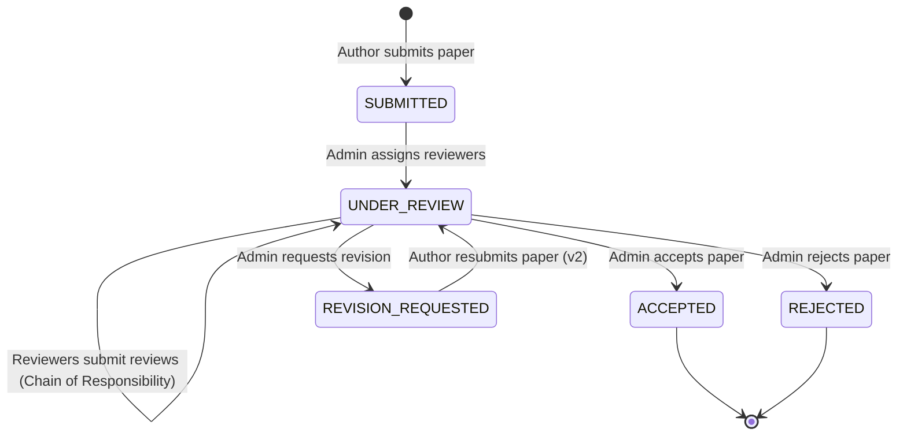
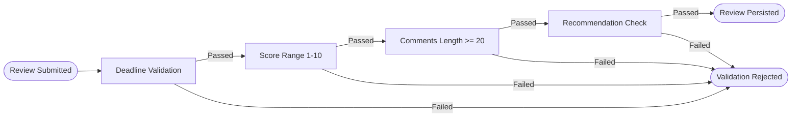

# 🎓 Conference Management System (CMS)

[](https://spring.io/projects/spring-boot)
[](https://openjdk.org/)
[](https://spring.io/projects/spring-security)
[](https://www.h2database.com/)
[](https://www.thymeleaf.org/)
[](LICENSE)

An enterprise-grade, full-stack **Conference Management System** developed as an **Object-Oriented Analysis and Design (OOAD)** project. The application streamlines the complete academic conference lifecycle—from call for papers, abstract and manuscript submissions, multi-criteria double-blind peer reviews, session and track scheduling, attendee registration and mock payment integration, to automated certificate generation and attendee feedback collection.

---

## 📑 Table of Contents

- [Core Features](#-core-features)
  - [Role-Based Access Control](#role-based-access-control)
  - [Feature Breakdown by Role](#feature-breakdown-by-role)
- [Software Architecture & Design Patterns](#-software-architecture--design-patterns)
  - [1. Singleton Pattern](#1-singleton-pattern-creational)
  - [2. Factory Method Pattern](#2-factory-method-pattern-creational)
  - [3. Builder Pattern](#3-builder-pattern-creational)
  - [4. Chain of Responsibility Pattern](#4-chain-of-responsibility-pattern-behavioral)
  - [5. Facade Pattern](#5-facade-pattern-structural)
- [SOLID Design Principles](#-solid-design-principles)
- [Workflows & Diagrams](#-workflows--diagrams)
- [Technology Stack](#-technology-stack)
- [Getting Started](#-getting-started)
  - [Prerequisites](#prerequisites)
  - [Running the Application](#running-the-application)
  - [Database & H2 Console](#database--h2-console)
- [Pre-seeded Demo Accounts](#-pre-seeded-demo-accounts)
- [Project Directory Structure](#-project-directory-structure)

---

## 🌟 Core Features

### Role-Based Access Control
The system features customized experiences and secured route-level authorization for five distinct user roles:

| Role | Primary Responsibility | Landing Route |
| :--- | :--- | :--- |
| **`ADMIN`** | System oversight, conference & session scheduling, reviewer assignment, certificate issuance | `/admin/dashboard` |
| **`AUTHOR`** | Abstract and paper submission, version revision, review feedback tracking | `/author/dashboard` |
| **`REVIEWER`** | Assigned paper evaluations, multi-criteria scoring, editorial recommendations | `/reviewer/dashboard` |
| **`SPEAKER`** | Keynote and session management, attendee feedback and rating analytics | `/speaker/dashboard` |
| **`ATTENDEE`** | Conference registration, workshop selection, mock payments, schedule browsing, feedback, certificate downloads | `/attendee/dashboard` |

---

### Feature Breakdown by Role

#### 👨‍💼 Administrator
- **Analytics Dashboard**: Real-time counts of users, conferences, papers, reviews, and session schedules.
- **Conference Lifecycle Management**: Create and configure conferences, set key deadlines (submissions, reviews, notification date), venue, attendee limits, and close conferences with automated certificate distribution.
- **Paper & Review Administration**: Monitor submitted papers, assign reviewers to manuscripts, and render final editorial decisions (`ACCEPTED`, `REJECTED`, `UNDER_REVIEW`).
- **Session & Track Scheduling**: Organize conference programs across multiple tracks (e.g., *AI & ML*, *Keynote*), assign rooms, set times, and link accepted papers with designated speakers.
- **Certificate Issuance**: Issue individual or bulk participation, presentation, reviewer, and best paper certificates via automated generator factories.
- **User Account Management**: View registered users across all roles and toggle account statuses.

#### ✍️ Author
- **Paper Submission Portal**: Upload research papers (PDF support, title, abstract, keywords, up to 10MB).
- **Abstract Submission**: Submit preliminary abstracts for approval prior to full paper upload.
- **Revision Tracking**: Resubmit revised drafts with revision comments and automated version incrementing.
- **Review Feedback**: Access peer-review scores, strengths, weaknesses, and reviewers' recommendations.

#### 🔍 Reviewer
- **Reviewer Dashboard**: View assigned papers pending review and completed evaluations.
- **Chain-Validated Review Form**: Submit structured evaluations featuring:
  - Numerical rating (1–10 scale)
  - Detailed written comments (minimum 20 characters)
  - Highlighted strengths & weaknesses
  - Recommendation (`ACCEPT`, `REJECT`, `MINOR_REVISION`, `MAJOR_REVISION`)
- **Review Deadline Enforcement**: Automatic validation rejecting submissions post-deadline.

#### 🎤 Speaker
- **Speaker Dashboard**: View confirmed presentations, keynotes, and scheduled tracks.
- **Audience Feedback Analytics**: Inspect real-time 1–5 star ratings, feedback statistics, and audience comments for each session.

#### 🎟️ Attendee
- **Conference Registration**: Choose from multiple tiers (`BASIC`, `VIP`, `WORKSHOP_ONLY`), select workshops, and declare dietary and accessibility preferences.
- **Integrated Mock Checkout**: Seamless payment simulation generating unique transaction IDs.
- **Interactive Schedule Viewer**: Browse conference sessions filtered by date, track, and room.
- **Session Feedback**: Submit star ratings (1–5) and written feedback for attended sessions.
- **Certificates**: Download verified participation and presentation certificates.

#### 💬 Cross-Cutting Features
- **Internal Messaging System**: Direct messaging between authors, reviewers, speakers, attendees, and admins (`/messages/inbox`).
- **Responsive UI**: Custom Tailwind-inspired layout with interactive modals, toast notifications, drag-and-drop file uploads, and star-rating inputs.

---

## 🏛️ Software Architecture & Design Patterns

The codebase is structured to exemplify classical Object-Oriented Design Patterns:

```
src/main/java/com/cms/pattern/
├── builder/        # ConferenceSchedule Builder & ScheduleDirector
├── chain/          # ReviewValidationChain & Handlers
├── facade/         # ConferenceFacade
├── factory/        # CertificateGenerator & CertificateGeneratorFactory
├── principles/     # DesignPrinciplesDoc (SOLID reference)
└── singleton/      # ConferenceAppConfig
```

### 1. Singleton Pattern (Creational)
- **Class**: `com.cms.pattern.singleton.ConferenceAppConfig`
- **Implementation**: Thread-safe Bill Pugh / Initialization-on-demand holder idiom (`Holder` static class).
- **Purpose**: Guarantees a single, globally accessible instance holding system-wide rules (maximum reviewers per paper, score range 1–10, review window duration, maximum upload size, and abstract word counts) without synchronization overhead.

### 2. Factory Method Pattern (Creational)
- **Classes**: `CertificateGenerator`, `CertificateGeneratorFactory`, and concrete creators:
  - `ParticipationCertGenerator`
  - `PresentationCertGenerator`
  - `BestPaperCertGenerator`
  - `ReviewerCertGenerator`
- **Purpose**: Decouples certificate generation logic from the certificate issuance service. Spring automatically injects all `CertificateGenerator` implementations into `CertificateGeneratorFactory`, honoring the **Open/Closed Principle**—adding a new certificate type requires only a new generator class with `@Component`.

### 3. Builder Pattern (Creational)
- **Classes**: `ConferenceSchedule`, `ConferenceSchedule.Builder`, `ScheduleDirector`
- **Purpose**: Simplifies construction of complex, multi-attribute schedule objects containing dates, venues, multiple tracks, and nested sessions. `ScheduleDirector` provides predefined build recipes (`buildFullSchedule`, `buildDraftSchedule`).

### 4. Chain of Responsibility Pattern (Behavioral)
- **Classes**: `ReviewValidationHandler`, `ReviewValidationChain`, and concrete handlers:
  - `DeadlineValidationHandler`: Validates if review is submitted prior to conference deadline.
  - `ScoreRangeValidationHandler`: Checks numeric score boundaries (1 to 10).
  - `CommentsValidationHandler`: Enforces minimum feedback length (≥ 20 characters).
  - `RecommendationValidationHandler`: Ensures an explicit recommendation is chosen.
- **Purpose**: Review submissions pass through a decoupled validation pipeline. Each handler validates one requirement or delegates along the chain, making validation rules independently testable and extensible.

### 5. Facade Pattern (Structural)
- **Class**: `com.cms.pattern.facade.ConferenceFacade`
- **Purpose**: Offers a unified high-level interface that hides multi-service orchestration complexities from `AdminController`. For example, `closeConference(id)` coordinates across `ConferenceService`, `RegistrationService`, `CertificateServiceImpl`, and `SessionService` in a single atomic operation.

---

## 📐 SOLID Design Principles

Documented in `com.cms.pattern.principles.DesignPrinciplesDoc`:

1. **Single Responsibility Principle (SRP)**:
   - `PaperServiceImpl` manages paper persistence and uploads only.
   - Controllers handle HTTP routing only, delegating all domain logic to services.
   - Validation handlers individually check only one discrete business rule.
2. **Open/Closed Principle (OCP)**:
   - New certificate types can be added without altering `CertificateServiceImpl` or `CertificateGeneratorFactory`.
   - New review validations can be added without touching `ReviewServiceImpl`.
3. **Liskov Substitution Principle (LSP)**:
   - All `CertificateGenerator` subclasses can seamlessly substitute the base generator without altering client behavior.
   - Core services implement standard interfaces (`UserService`, `PaperService`, `SessionService`), enabling pluggable alternative implementations.
4. **Dependency Inversion Principle (DIP)**:
   - High-level controllers depend on abstractions (interfaces such as `PaperService`, `ReviewService`) rather than concrete implementations.

---

## 🔄 Workflows & Diagrams

### Paper Review Lifecycle


### Review Validation Chain


---

## 💻 Technology Stack

| Layer | Technology | Details |
| :--- | :--- | :--- |
| **Language** | Java 17 | Core language platform |
| **Framework** | Spring Boot 3.2.0 | Application framework |
| **Security** | Spring Security 6 | Role-based authorization & BCrypt password encryption |
| **Persistence** | Spring Data JPA / Hibernate | Object-relational mapping & repositories |
| **Database** | H2 Database | Fast, zero-config in-memory database |
| **View Layer** | Thymeleaf + HTML5 / CSS3 | Server-side templating engine |
| **PDF Generation** | iText 7 (7.2.5) | PDF document generation engine |
| **Utilities** | Project Lombok | Boilerplate elimination (`@Data`, `@Builder`, `@RequiredArgsConstructor`) |
| **Build Tool** | Apache Maven | Dependency management and build packaging |

---

## 🚀 Getting Started

### Prerequisites
- **Java Development Kit (JDK) 17** or higher installed. Check with:
  ```bash
  java -version
  ```
- **Git** installed on your system.

### Running the Application

1. **Clone the repository:**
   ```bash
   git clone https://github.com/<your-username>/Conference-Management-System-debugged.git
   cd Conference-Management-System-debugged
   ```

2. **Run using Maven Wrapper:**
   - **Linux / macOS:**
     ```bash
     ./mvnw spring-boot:run
     ```
   - **Windows:**
     ```powershell
     .\mvnw.cmd spring-boot:run
     ```

   *(Alternatively, if you have Maven installed globally, run `mvn spring-boot:run`)*

3. **Open the application in your browser:**
   ```
   http://localhost:8080
   ```

---

### Database & H2 Console

The project runs with an in-memory H2 database configured with `create-drop` DDL. Test data is automatically seeded upon startup via `DataInitializerService`.

- **H2 Web Console URL:** `http://localhost:8080/h2-console`
- **JDBC URL:** `jdbc:h2:mem:cmsdb`
- **Username:** `sa`
- **Password:** *(leave blank)*

---

## 🔑 Pre-seeded Demo Accounts

For grading, demonstration, and testing convenience, `DataInitializerService` initializes the system with the following accounts:

| Role | Username | Password | Full Name | Affiliation |
| :--- | :--- | :--- | :--- | :--- |
| **Admin** | `admin` | `admin123` | Admin User | CMS HQ |
| **Author** | `alice` | `alice123` | Alice Johnson | MIT |
| **Author** | `bob` | `bob123` | Bob Smith | Stanford |
| **Reviewer** | `carol` | `carol123` | Carol Williams | Cambridge |
| **Reviewer** | `dave` | `dave123` | Dave Brown | Oxford |
| **Speaker** | `eve` | `eve123` | Eve Davis | Google Research |
| **Speaker** | `frank` | `frank123` | Frank Miller | Microsoft Research |
| **Attendee** | `grace` | `grace123` | Grace Lee | IIT Bombay |
| **Attendee** | `henry` | `henry123` | Henry Wilson | IISc Bangalore |

> [!TIP]
> You can also register a new account on `/register` with any desired role (**Author**, **Reviewer**, **Speaker**, or **Attendee**).

---

## 📁 Project Directory Structure

```
Conference-Management-System-debugged/
├── pom.xml                                    # Maven configuration & dependencies
├── mvnw / mvnw.cmd                            # Maven wrapper scripts
├── uploads/                                   # Uploaded paper manuscripts directory
└── src/
    └── main/
        ├── java/com/cms/
        │   ├── ConferenceManagementApplication.java  # Main Spring Boot application entry point
        │   ├── config/                        # Security & Login Success Handlers
        │   ├── controller/                    # MVC Controllers (Admin, Author, Reviewer, etc.)
        │   ├── exception/                     # Global exception handling
        │   ├── model/                         # JPA Entities (User, Paper, Conference, Review, etc.)
        │   ├── pattern/                       # OOAD Design Patterns
        │   │   ├── builder/                   # Builder Pattern: Schedule building
        │   │   ├── chain/                     # Chain of Responsibility: Review validation
        │   │   ├── facade/                    # Facade Pattern: Admin conference coordination
        │   │   ├── factory/                   # Factory Method: Certificate generation
        │   │   ├── principles/                # SOLID principles documentation
        │   │   └── singleton/                 # Singleton: Conference configuration
        │   ├── repository/                    # Spring Data JPA Repositories
        │   └── service/                       # Business logic interfaces & implementations
        └── resources/
            ├── application.properties         # Server, JPA, & H2 datasource configuration
            ├── import.sql                     # Post-schema SQL initialization
            ├── static/
            │   ├── css/style.css              # Custom styling
            │   └── js/app.js                  # Frontend interactions & dynamic behaviors
            └── templates/                     # Thymeleaf HTML views
                ├── admin/                     # Admin dashboard, papers, sessions, certs
                ├── attendee/                  # Attendee registration, schedule, feedback
                ├── auth/                      # Login & Registration views
                ├── author/                    # Paper & abstract submission views
                ├── common/                    # Shared layouts, navigation, and messaging
                ├── reviewer/                  # Review forms and dashboard
                └── speaker/                   # Speaker sessions and feedback view
```

---
